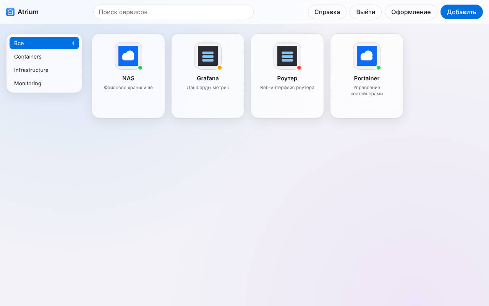
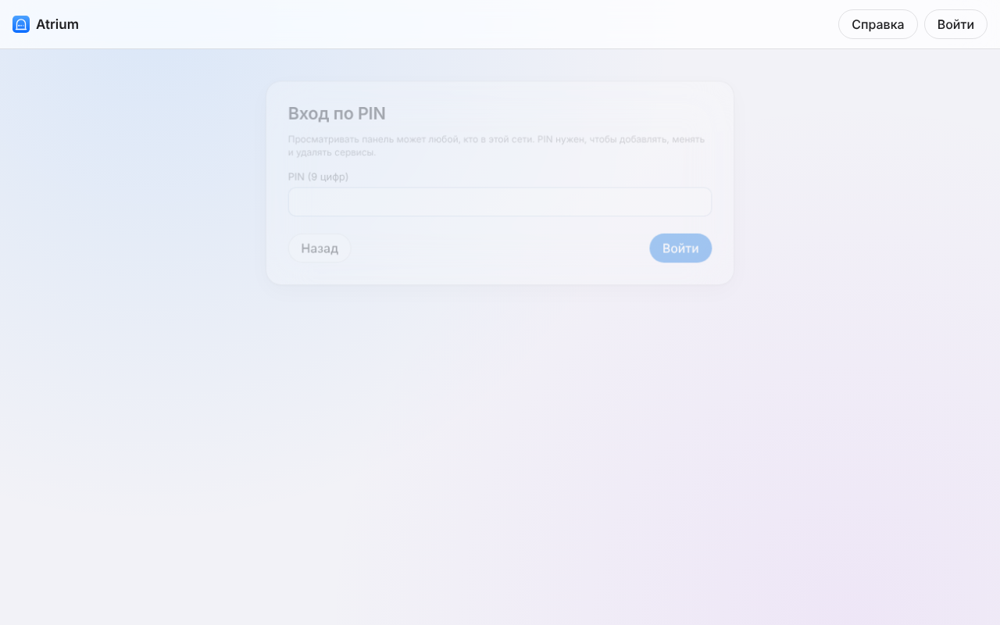
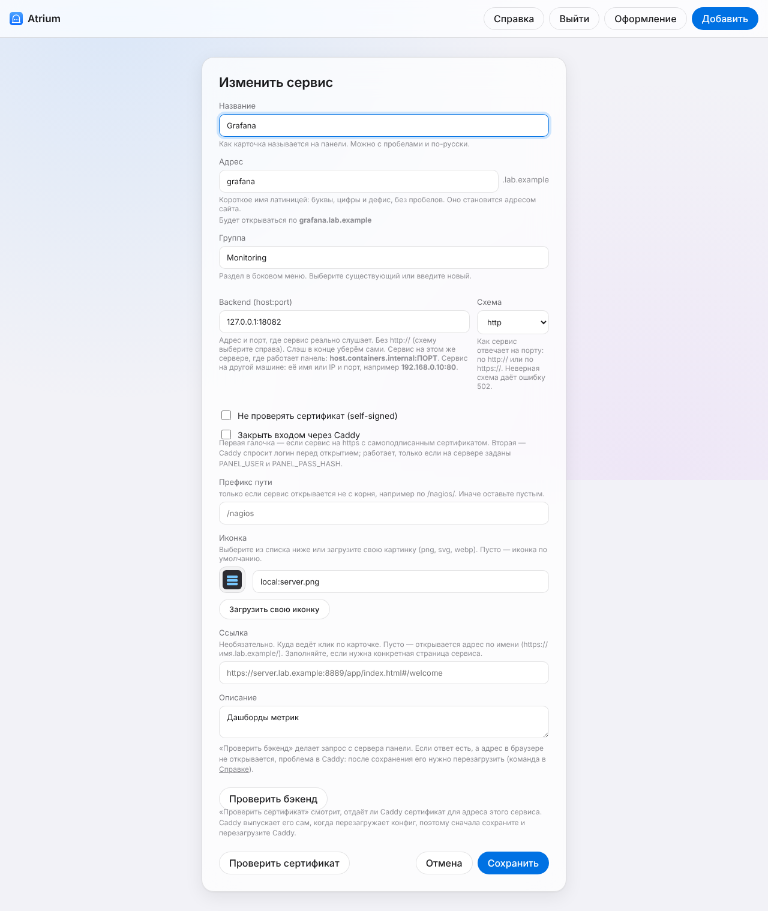
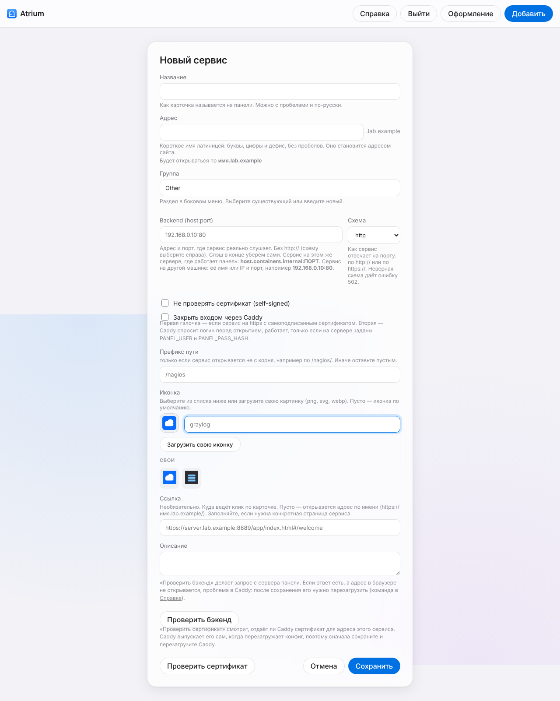
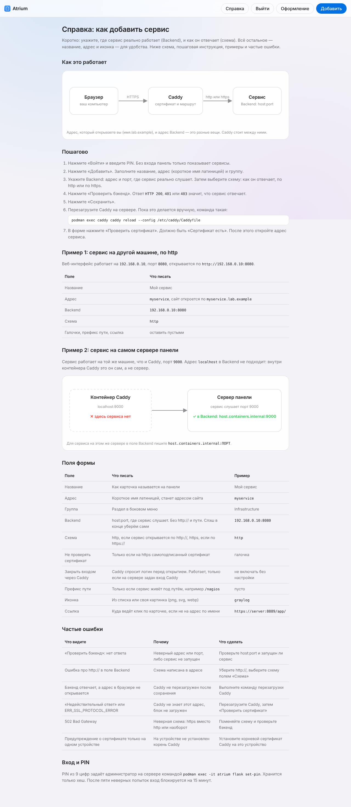
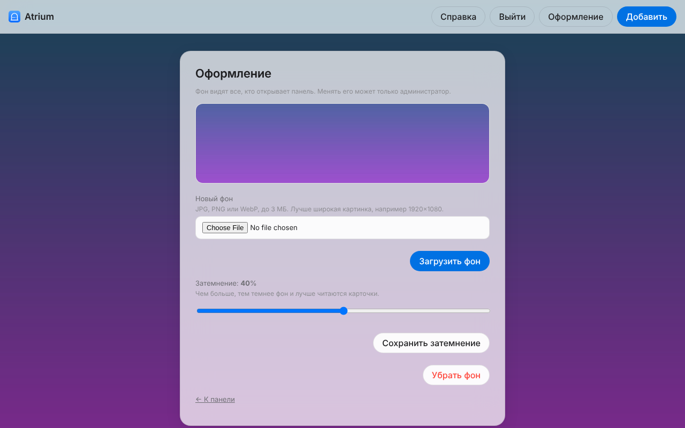
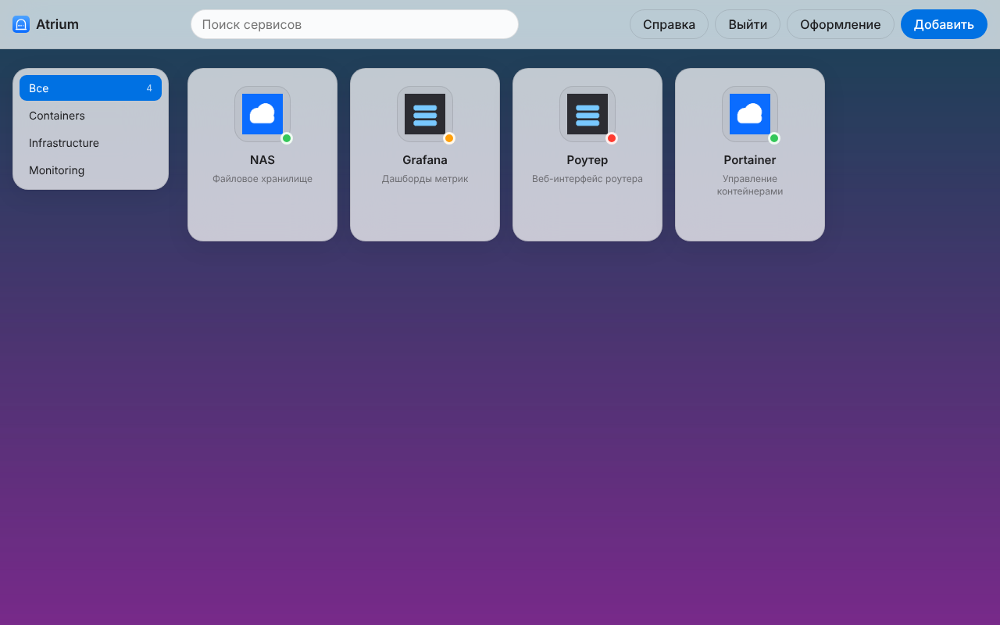

<p align="center">
  
</p>

# Atrium

Панель и редактор каталога сервисов домашней лаборатории. Flask-приложение, которое:

- показывает плитки сервисов с живыми статусами (точка: работает, нужен вход, недоступен);
- даёт добавлять, менять и удалять сервисы через веб-интерфейс;
- генерирует конфиг Caddy и поддерживает загрузку своих иконок;
- проверяет бэкенд и сертификат прямо из формы;
- позволяет поставить фон панели: один для всех.

Редактирование защищено PIN-кодом из 9 цифр. Просмотр открыт всем, кто имеет доступ к панели.

## Быстрый старт

```bash
podman build -t atrium .
mkdir -p data && cp services.example.yaml data/services.yaml && cp generate.py data/
podman run --rm -it -v "$PWD/data:/data:z" atrium flask set-pin
podman run -d --name atrium -p 5000:5000 -v "$PWD/data:/data:z" \
  -e CADDY_IMPORT=/data/Caddyfile.apps atrium
```

Откройте `http://localhost:5000`. Для редактирования войдите по PIN.

Подробности развёртывания: [deploy/README.md](deploy/README.md).

## Структура

- `app/` — приложение Flask, шаблоны и статика
- `generate.py` — генератор конфига Caddy из `services.yaml`
- `services.example.yaml` — пример каталога сервисов
- `deploy/` — примеры для systemd и инструкция по развёртыванию

## Скриншоты

Снимки сделаны на демо-данных: адреса и сервисы условные, статусы — настоящие, от локальных заглушек.

**Главный экран (администратор).** Плитки с живыми статусами: зелёная — работает, оранжевая — нужен вход, красная — недоступен.


**Вход по PIN.** Просмотр доступен без входа, менять сервисы можно только после ввода PIN.


**Редактирование сервиса.** Подсказки у каждого поля, проверка бэкенда до сохранения.


**Иконки.** Свои иконки показываются первыми. Загруженные картинки попадают в тот же список.


**Проверка сертификата.** Снимок сделан, когда контейнер Caddy недоступен, поэтому видно сообщение об ошибке. С работающим Caddy кнопка сообщает, до какого числа действует сертификат.


**Справка.** Схема работы, пошаговая инструкция, примеры и частые ошибки.


**Оформление.** Фон один для всех, затемнение и кнопка «Убрать фон». Менять может только администратор.




## Личные данные

В репозитории нет адресов, паролей и ключей. Файлы `services.yaml`, `admin.json`, `secret.key`, `settings.json`, `backgrounds/`, `icons/` и каталог Caddy с сертификатами создаются на сервере и в `.gitignore`.

## Требования

Python 3.11, Flask, PyYAML, requests, cryptography (см. `requirements.txt`). Для работы с Caddy нужен Caddy 2 с локальным центром сертификатов (`tls internal`).
